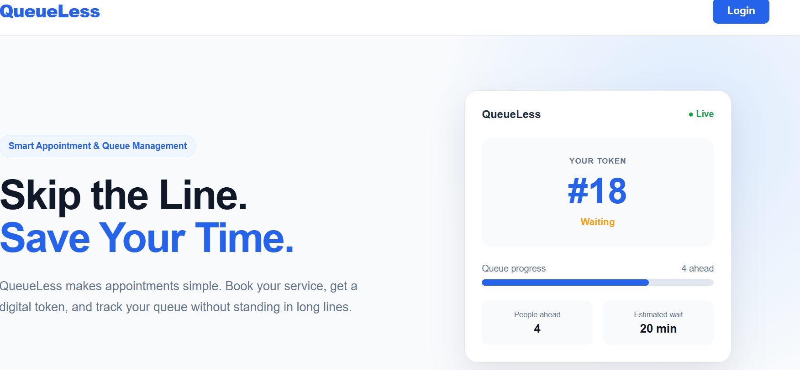
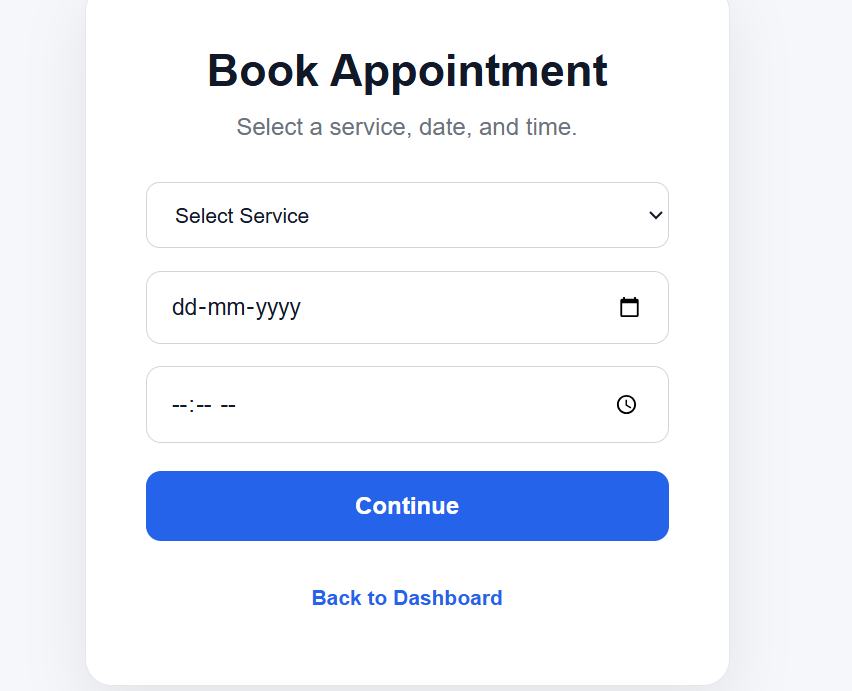
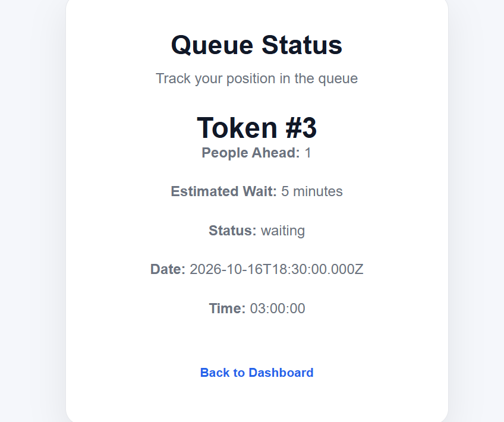
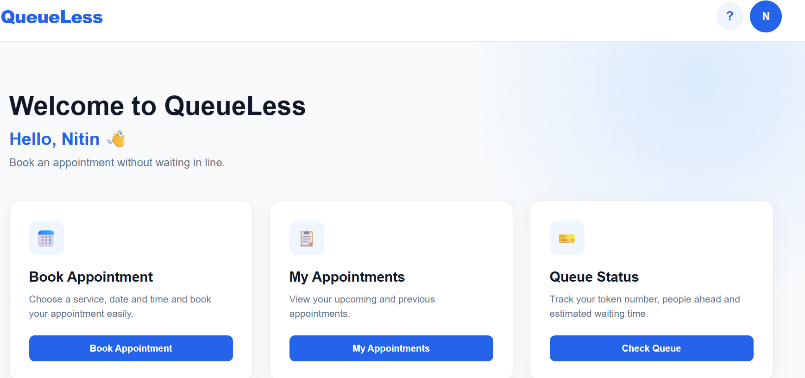
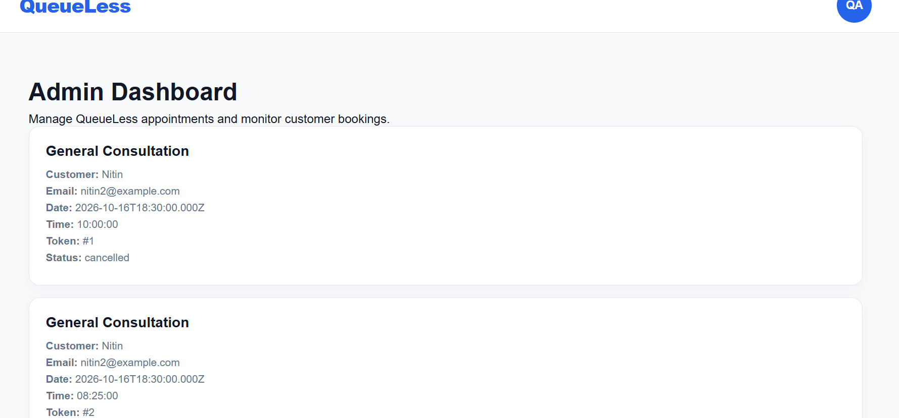
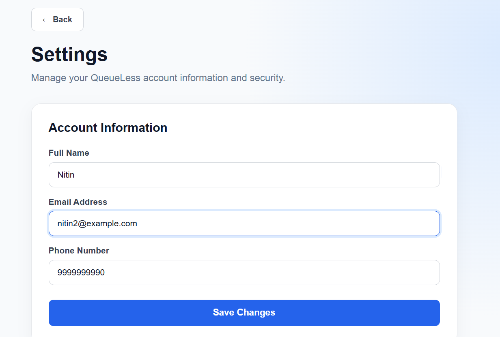

QueueLess — Smart Appointment & Queue Management System

QueueLess is a full-stack web application designed to simplify appointment booking and digital queue management.

Instead of waiting in long physical queues, customers can book appointments, receive a digital token, view their queue position, and track their estimated waiting time.

The project was built to demonstrate practical full-stack development using modern frontend, backend, database, authentication, and REST API technologies.

---

🚀 Key Features

👤 Customer Features

- Customer registration and login
- Secure password authentication
- Book appointments online
- Select services, dates, and available time slots
- Receive a digital queue token
- View people ahead in the queue
- View estimated waiting time
- View upcoming and previous appointments
- Cancel appointments
- View appointment details

🛠️ Admin Features

- Secure admin login
- View customer appointments
- Manage appointment status
- Monitor the appointment queue
- Manage the overall appointment workflow

🔐 Authentication & Security

- JWT-based authentication
- Password hashing using bcrypt
- Role-based authorization
- Separate customer and admin access
- Environment variables for sensitive database configuration

---

💡 Problem Statement

Traditional appointment and queue systems can cause:

- Long waiting times
- Unclear queue positions
- Manual appointment management
- Difficulty tracking appointments
- Poor visibility for customers

QueueLess addresses these problems by providing a digital appointment and queue management system.

---

✨ What Makes QueueLess Different?

A key feature of QueueLess is its digital queue tracking system.

For example:

«Token #18
4 people ahead
Estimated waiting time: 20 minutes»

This allows customers to understand their position in the queue instead of waiting without knowing when their turn will arrive.

---

🏗️ Technology Stack

Frontend

- HTML
- CSS
- JavaScript
- React
- Vite

Backend

- Node.js
- Express.js
- REST APIs

Database

- MySQL

Authentication & Security

- JWT
- bcryptjs
- Environment variables

Development Tools

- Visual Studio Code
- Git
- GitHub
- npm

---

📂 Project Structure

QueueLess/
│
├── backend/
│   ├── config/
│   ├── middleware/
│   ├── routes/
│   ├── services/
│   ├── .env
│   ├── server.js
│   └── package.json
│
├── frontend/
│   ├── src/
│   │   ├── components/
│   │   ├── pages/
│   │   ├── App.jsx
│   │   └── App.css
│   ├── package.json
│   └── vite.config.js
│
└── README.md

«Note: The ".env" file is intentionally excluded from GitHub because it contains sensitive configuration.»

---

🔄 Application Flow

Customer
   │
   ▼
Register / Login
   │
   ▼
Customer Dashboard
   │
   ├── Book Appointment
   │       │
   │       ▼
   │   Digital Token
   │       │
   │       ▼
   │   Queue Tracking
   │
   ├── My Appointments
   │
   └── Appointment Details

Admin:

Admin Login
     │
     ▼
Admin Dashboard
     │
     ▼
View & Manage Appointments
     │
     ▼
Monitor Queue

---

🔌 REST API Structure

The backend follows a REST API architecture.

Main API areas include:

/api/auth
/api/services
/api/appointments
/api/my-appointments
/api/queue
/api/admin

These APIs connect the React frontend with the Node.js/Express backend and MySQL database.

---

🗄️ Database

QueueLess uses MySQL for persistent data storage.

The database contains tables for areas such as:

- Users
- Services
- Appointments
- Queue

The system supports different user roles, including:

Customer
Admin

---

🔐 Security Practices

Sensitive configuration is stored using environment variables rather than being hard-coded into the application.

Example:

DB_HOST=localhost
DB_USER=root
DB_PASSWORD=your_password
DB_NAME=queueless
JWT_SECRET=your_secret

The ".env" file is excluded from version control.

Never upload real passwords, API keys, database credentials, or JWT secrets to GitHub.

---

⚙️ Running the Project Locally

1. Clone the repository

git clone https://github.com/praveenkumarpandrinki-blip/QueueLess.git

cd QueueLess

2. Install frontend dependencies

cd frontend
npm install

Start the frontend:

npm run dev

3. Install backend dependencies

Open another terminal:

cd QueueLess/backend
npm install

Start the backend:

node server.js

The backend runs on:

http://localhost:5000

The frontend normally runs on the Vite development URL shown in the terminal.

---

🧪 Testing

The application was tested for core workflows including:

- Customer registration
- Customer login
- Admin login
- Appointment booking
- Appointment management
- Queue tracking
- Database connectivity
- Role-based access
- Logout functionality

---

🎯 Project Goals

QueueLess was developed to demonstrate practical experience in:

- Full-stack web development
- React application development
- REST API development
- Node.js and Express
- MySQL database integration
- Authentication and authorization
- Secure configuration management
- Git and GitHub
- Frontend-backend integration

---

🔮 Future Improvements

Possible future enhancements include:

- Real-time queue updates using WebSockets
- Email/SMS appointment notifications
- Online appointment reminders
- Advanced admin analytics
- Service provider management
- Cloud deployment
- Mobile application
- Docker support
- Automated testing and CI/CD

---

👨‍💻 Developer

Praveen Kumar

B.Tech — Computer Science & Engineering

This project was developed as a practical full-stack application to strengthen software development skills and demonstrate real-world problem solving.

---

📄 License

This project is created for educational and portfolio purposes.
## Screenshots

### Home Page

### Appointment Booking

### Queue Status

### Customer Dashboard

### Admin Dashboard

### Settings

